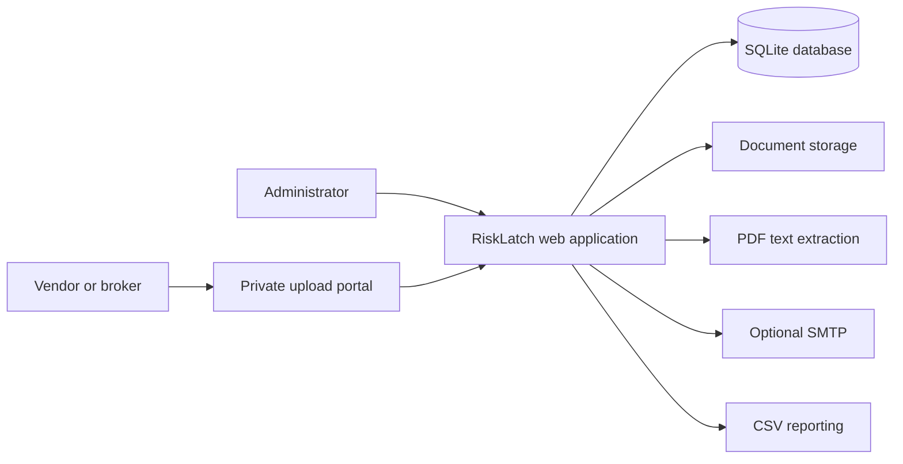

# RiskLatch v2.0 — Risk Operations Platform

**Lock Down Risk. Unlock Confidence.**


RiskLatch is a self-hosted vendor compliance and risk operations platform designed for commercial contractors, property managers and facilities teams. It brings insurance documentation, vendor requirements, renewal tracking and payment review into a centralized workspace.

> **Development preview:** RiskLatch currently supports one organization and is intended for evaluation with synthetic data. It is not a production-ready compliance or insurance verification service.

## Contents

- [The problem](#the-problem)
- [Capabilities](#capabilities)
- [How it works](#how-it-works)
- [Architecture](#architecture)
- [Getting started](#getting-started)
- [Configuration](#configuration)
- [Security and limitations](#security-and-limitations)
- [Roadmap](#roadmap)

## The problem

Contractors and property managers frequently rely on spreadsheets, shared folders and email threads to track vendor insurance, licenses and payment documentation. Missing paperwork, expired coverage and inconsistent project requirements can create costly operational risks.

RiskLatch aims to replace fragmented administrative workflows with a single, reviewable record of vendor compliance.

## Capabilities

| Module | Current capabilities |
| --- | --- |
| Vendor management | Centralized vendor records and document checklists |
| Document management | PDF uploads for insurance certificates, W-9s and lien waivers |
| Vendor portal | Private upload links for external document submissions |
| Insurance review | PDF text extraction and human-reviewed coverage limits and expiration dates |
| Project compliance | Project creation, vendor assignments and configurable requirements |
| Coverage tracking | General liability, umbrella, workers' compensation employer liability and commercial auto requirements |
| License tracking | Vendor license requirements and review |
| Renewal management | Expiration indicators and 60-day renewal calendar |
| Payment review | Invoice queue, lien waiver attestations and advisory clearance decisions |
| Communications | Reminder drafts and optional SMTP delivery initiated by an operator |
| Reporting | Compliance CSV exports and audit activity |

### Designed for

- General contractors managing subcontractors across multiple projects
- Commercial property management teams coordinating service vendors
- Facilities and maintenance departments tracking contractor documentation
- Risk and accounts payable teams reviewing compliance before payment

## How it works

1. **Onboard:** Create a vendor record and configure the applicable requirements.
2. **Collect:** Share a private upload link with the vendor or its insurance representative.
3. **Review:** Examine submitted documents, original policies and endorsements; record coverage details and review decisions.
4. **Assign:** Associate vendors with projects and monitor applicable requirements.
5. **Monitor:** Review expiration indicators, renewal calendars and missing documentation.
6. **Communicate:** Generate reminder drafts and send them manually when SMTP is configured.
7. **Review payment:** Record invoice-level attestations and advisory payment recommendations.
8. **Report:** Export compliance information and review recorded audit activity.

Payment recommendations do not authorize, block or execute payments in an accounting system.

## Architecture

RiskLatch uses a lightweight Python web application designed for straightforward self-hosting.

| Layer | Technology |
| --- | --- |
| Application | Python / Flask |
| Interface | Server-rendered HTML and CSS |
| Database | SQLite |
| Document processing | PyPDF text extraction |
| Application server | Gunicorn |
| Deployment | Docker / Docker Compose |
| Email | Configurable SMTP |



## Getting started

### Prerequisites

- Linux host or another Docker-compatible environment
- Docker Engine and Docker Compose
- OpenSSL
- Git

### Installation

```bash
git clone https://github.com/cuzzaintit321/risklatch.git
cd risklatch
chmod +x setup.sh
./setup.sh
```

The repository is private; authenticated GitHub access is required. The setup script generates administrator credentials, stores configuration in `.env` and starts the application.

Open **http://localhost:8125** on the Docker host. For remote evaluation, use SSH port forwarding:

```bash
ssh -N -L 8125:127.0.0.1:8125 user@server
```

Sign in and open `/operations` to access the v2.0 operations workspace.

### Container management

```bash
docker compose ps
docker compose logs -f
docker compose up -d --build
docker compose down
```

Back up the named data volume before upgrading. Do not use `docker compose down -v` unless you intend to delete persistent data. The original SubClear volume is not automatically migrated when renaming the Compose project.

## Configuration

Configuration is stored in `.env`. Never commit this file or real vendor documents to GitHub.

| Setting | Purpose |
| --- | --- |
| `SECURE_COOKIE` | Set to 1 for HTTPS deployment |
| `PUBLIC_BASE_URL` | HTTPS base URL used in external links |
| `SMTP_HOST` | SMTP server |
| `SMTP_PORT` | SMTP server port |
| `SMTP_FROM` | Sender address |
| `SMTP_USER` | Optional SMTP username |
| `SMTP_PASSWORD` | Optional SMTP password |

Email reminders are manually generated and sent; scheduled delivery is not implemented. Use a trusted reverse proxy with HTTPS for any network-accessible evaluation. Do not expose plain HTTP to the public internet.

## Security and limitations

RiskLatch is an early-stage prototype. **Use synthetic documents only.** Real W-9s, insurance policies and other sensitive records should not be uploaded until appropriate encryption, access controls, retention policies, malware scanning, rate limiting, audit hardening and independent security review are implemented.

- Single-organization deployment; no multi-tenant isolation or multi-user role management.
- Upload links are reusable bearer credentials until rotated.
- PDF text extraction is not OCR and may not read scanned documents.
- Insurance coverage and endorsements require qualified human review. A certificate alone does not establish coverage.
- Invoice-specific waiver attestations are not a complete electronic signature or legal waiver management system.
- Payment decisions are advisory; accounting integrations and automated payment holds are not implemented.
- No subscription billing, SMS or scheduled reminder service.
- No production security audit or assurance of regulatory compliance.

RiskLatch does not provide legal, accounting or insurance advice.

## Roadmap

The following items are planned, not currently available.

| Milestone | Planned work |
| --- | --- |
| Security foundation | Multi-tenancy, role-based access, encrypted storage, upload hardening and security testing |
| Document intelligence | OCR, structured ACORD extraction, confidence scores and reviewer workflows |
| Automation | Scheduled renewal notifications, broker follow-ups and escalation rules |
| Integrations | QuickBooks Online, Procore, REST API and webhooks |
| Commercial platform | Subscription billing, organization onboarding and operational monitoring |
| Enterprise capabilities | SSO, advanced reporting, configurable policies and audit exports |

## Project status

RiskLatch v2.0 is under active development. The current release focuses on validating core compliance and risk operations workflows before introducing production-grade automation and commercial integrations.

---

**RiskLatch** · Vendor Compliance · Insurance Review · Risk Operations
